# Unofficial Symphony Maestro for Apogee Symphony I/O MK I

_Note: I don’t have a tip jar, but if you find this useful and you’re motivated to donate, please feel free to make a donation in my name to the [SF-Marin Food Bank](https://www.sfmfoodbank.org). That would certainly mean a lot to me. They’re a great organization and incredibly efficient with their funds._

Modern Apple Silicon support for the Apogee Symphony I/O MK I over **USB and ThunderBridge**, on **macOS 26 (Tahoe) and macOS 27 (Golden Gate)**.

**Download:** <a href="https://github.com/danielraffel/unofficial-symphony-maestro-mk1/releases/latest/download/UnofficialSymphonyMaestro.pkg">
Download the latest Unofficial Symphony Maestro (.pkg)
</a> &nbsp;·&nbsp; <a href="https://github.com/danielraffel/unofficial-symphony-maestro-mk1/releases">all releases</a>

For what changed in each version, see the [release notes](https://github.com/danielraffel/unofficial-symphony-maestro-mk1/releases). Maestro also includes an optional in-app updater: **Check for Updates…** is always available, and scheduled checks can be turned off in **Device Settings › Preferences**.

_**Note:** This software has had limited real-world testing. Please read the disclaimers in this README and the license agreement before installing._

## Overview

This project restores support for the **Apogee Symphony I/O MK I** on Apple Silicon Macs. It was developed with **Apogee's knowledge and blessing**, but it is **not affiliated with, supported by, or endorsed by Apogee** in any way. Apogee does not provide support for this software.

Due to the technical approach used, this software **requires an Apple Silicon Mac running macOS 26 or later**. It will **never support Intel Macs or versions of macOS earlier than macOS 26**.

## What's Included

- **Maestro**, a native macOS app for device configuration: inputs, outputs, monitor section, two low-latency mixers, input and output routing with presets, device and system settings
- A native **ThunderBridge DriverKit driver** (32 channels in and out, 44.1–192 kHz, ADAT and optical output)
- A modern **USB** implementation using Apple's USB audio stack, with hardware volume-key support
- Automatic recovery when the Symphony is powered off and on or a cable is replugged, on either connection
- Appearance controls with **Auto**, **Light**, and **Dark** modes
- Optional in-app updates through Sparkle

### Connecting over USB and ThunderBridge

Both connections can stay plugged in. The Symphony's front-panel mode decides which one Maestro uses: in **Symphony** mode audio and control go through ThunderBridge, and in a **USB** mode they go through USB. Switching modes on the front panel is followed automatically.

Over USB the Mac sees two devices. **Symphony I/O : Maestro USB** is the one to use: it carries the hardware volume-key control that the class-compliant **Symphony I/O : USB Audio** device cannot. USB carries 16 channels each way; ThunderBridge carries 32.

### Microphone permission

On first launch Maestro asks for microphone access. It reads the Symphony's input channels only to draw its input meters; nothing is recorded or stored. On macOS 27 the input meters do not work without it.

## Appearance and updates

Maestro follows your Mac by default with **Auto** appearance. You can choose **Light** or **Dark** in **Device Settings › Preferences**; the choice applies only to Maestro and is saved for the next launch.

Updates are downloaded from this repository; the updater collects no telemetry.

<table>
<tr>
<td width="50%"><a href="docs/screenshots/update-available.png">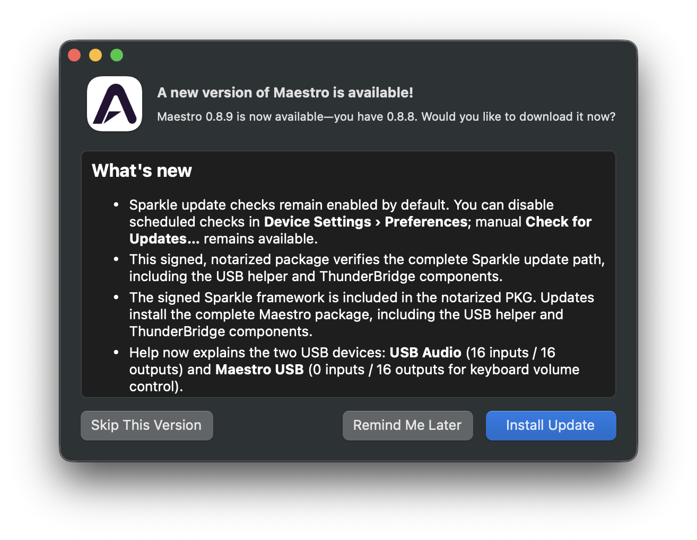</a> Update notifications show the release notes before you install.</td>
<td width="50%"><a href="docs/screenshots/update-current.png">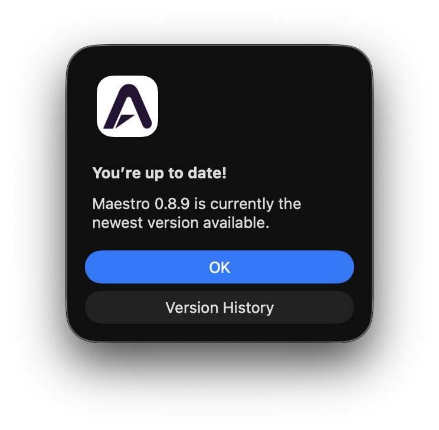</a> Manual checks also report when you are already up to date.</td>
</tr>
</table>

## Screenshots

<table>
<tr>
<td width="50%"><a href="docs/screenshots/input.png">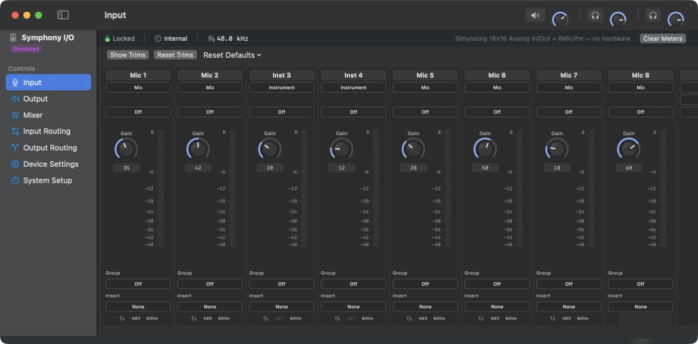</a> <b>Input</b> — a strip per installed converter: analog and digital reference, soft limiter, meters, and trims on demand.</td>
<td width="50%"><a href="docs/screenshots/output.png">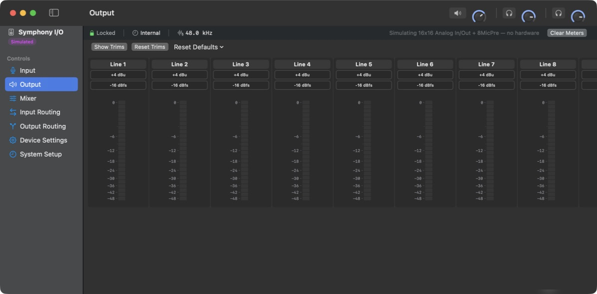</a> <b>Output</b> — the same per channel on the way out, plus the monitor section to the right.</td>
</tr>
<tr>
<td width="50%"><a href="docs/screenshots/headphones-speakers.png">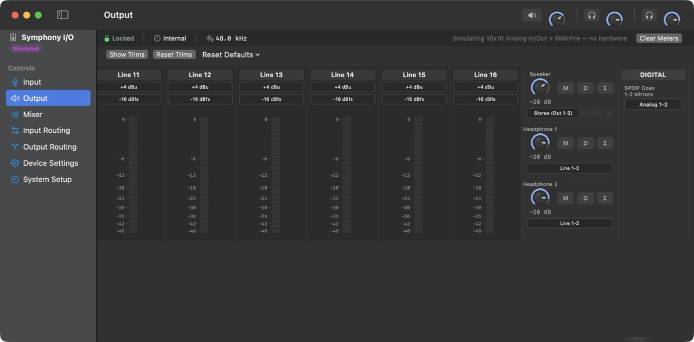</a> <b>Speaker and headphones</b> — the monitor section: level, Mute / Dim / Sum, and what each output listens to.</td>
<td width="50%"><a href="docs/screenshots/mixer.png">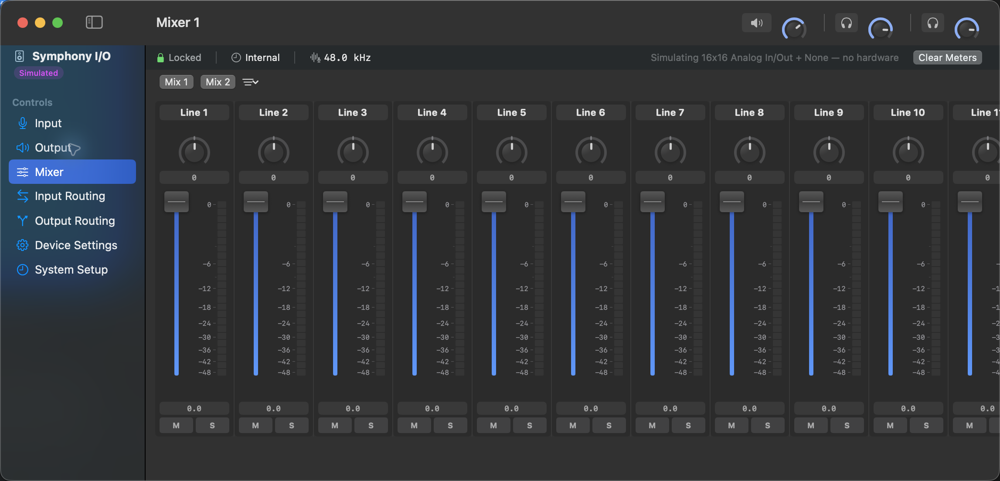</a> <b>Mixer</b> — two low-latency mixes, each with pan, fader, mute and solo.</td>
</tr>
<tr>
<td width="50%"><a href="docs/screenshots/input-routing.png">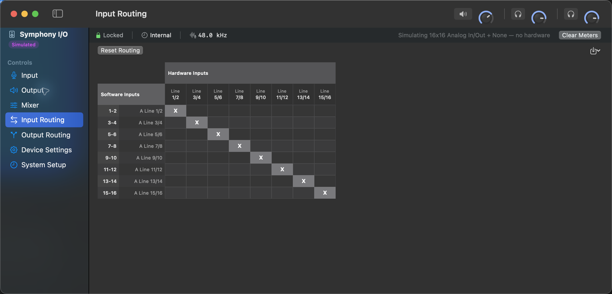</a> <b>Input Routing</b> — which hardware input feeds which software input.</td>
<td width="50%"><a href="docs/screenshots/output-routing.png">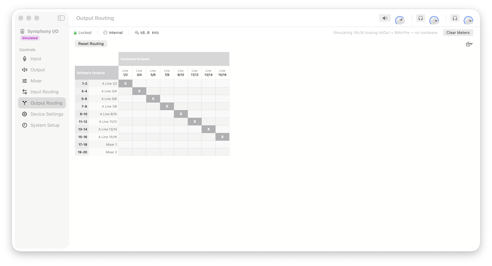</a> <b>Output Routing</b> — which software output or mix feeds which hardware output.</td>
</tr>
<tr>
<td width="50%"><a href="docs/screenshots/device-settings.png">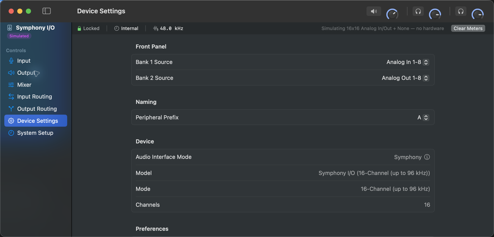</a> <b>Device Settings</b> — front-panel meter banks, peripheral prefix, and editable insert labels.</td>
<td width="50%"><a href="docs/screenshots/system-setup.png">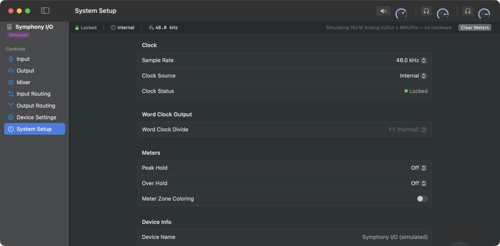</a> <b>System Setup</b> — clock and sample rate, word clock divide, meter hold behaviour, and what is installed.</td>
</tr>
</table>

### Mic Pre

With an 8MicPre installed, channels 1-8 gain a preamp: gain, 48 V phantom, polarity, an 80 Hz high-pass, Group, and the Insert controls. Only the first four channels offer Instrument, because that is how many 1/4" jacks the module has.

<a href="docs/screenshots/input-micpre.png">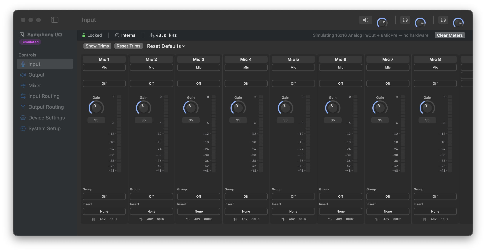</a>

> **The device-control screenshots use Maestro’s built-in card simulator**, with a 16x16 Analog In/Out module and an 8MicPre where shown. The “no hardware” banner identifies simulated views; the Sparkle update dialogs above are from a real update. I don't own an 8MicPre; the Mic Pre controls are built from Apogee's own source and have been exercised by one tester on real hardware (see [Tested Hardware](#tested-hardware)).

## Requirements

- Apple Silicon Mac (M-series)
- macOS 26 (Tahoe) or macOS 27 (Golden Gate)
- Apogee Symphony I/O MK I, connected over USB or an Apogee ThunderBridge

_Intel Macs and earlier versions of macOS are not supported. The original Symphony 64 PCIe card (in a Thunderbolt chassis) is not supported yet._

## Beta Status

This is **beta software** developed by one person. It has been tested on a small number of systems, listed below. If your Mac is mission-critical, test on a secondary machine first.

## Tested Hardware

Verified by me, on macOS 26 and macOS 27:

- Symphony I/O MK I with an **8×8 Analog + Optical** module and a **16 Analog In / 16 Digital Out** module, over **USB** and **ThunderBridge**

Reported working by testers (thank you):

- **8×8 Analog + Optical**, single module, over ThunderBridge, macOS 26
- **16×16 Analog** + ADAT over ThunderBridge, macOS 27
- **16×16 Analog** over USB, macOS 26 and 27
- **16×16 Analog** + **8MicPre** over USB, macOS 26

If your configuration differs, it may well work, but it has not been verified. The **2×6** module has not been tested on real hardware.

## Installation

The installer is Apple signed and notarized, so no security workarounds are needed. Install, launch Maestro, and approve the driver extension when macOS asks (ThunderBridge users). When a release updates the driver extension, one ThunderBridge cable unplug/replug lets the new driver take over; the release notes say when that applies.

The installer includes a <a href="https://github.com/danielraffel/unofficial-symphony-maestro-mk1/blob/main/license.md">conservative license agreement</a> stating that the software is provided **as-is**, without warranty.

## Feedback

If you have a Symphony I/O MK I and an Apple Silicon Mac, I’d appreciate hearing how it goes.

If you encounter problems, please <a href="https://github.com/danielraffel/unofficial-symphony-maestro-mk1/issues/new">file an issue</a> and include:

* The Maestro version (**Maestro › About**) and macOS version
* Whether you’re using USB or ThunderBridge
* Installed I/O modules
* Mac model

If everything works, a <a href="https://github.com/danielraffel/unofficial-symphony-maestro-mk1/issues/new">short issue</a> saying so is just as valuable: it tells others which configurations have been tested, and it gets added to the list above.

## Support

This is an independent community project. Apogee does **not** provide support for this software. Please direct all feedback, bug reports, and questions to this project's GitHub Issues page.

Assuming testing continues to go well, I’ll explore open-sourcing the software. There are a few complexities to work through, so that’s a lower priority for now, and I can’t promise it will happen.

## Acknowledgments

Many thanks to Apogee for their cooperation during development, for trusting me and for making it possible to explore restoring support for this hardware on modern versions of macOS. “Apogee”, “Symphony” and "Maestro" are trademarks of their respective owners, used here only for identification and compatibility.

Thanks also to the testers who have filed detailed reports on GitHub and in the Gearspace thread; most of the fixes since the first beta came directly from them.

During development I sent countless commands that could easily have bricked my device, while I did have to reboot my machine a lot I never encountered a single unrecoverable issue. That’s a real testament to the engineering and care that went into the Apogee firmware. The team clearly designed it to guard against invalid states, preventing me from ever putting the hardware into a bad or unrecoverable condition. Respect.

## Appendix
- <a href="https://knowledge.apogeedigital.com/legacy-symphony-i/o-mk-i-guide-for-intel-and-apple-silicon-macs">About Apogee Symphony I/O MK I</a> 
- <a href="https://www.soundonsound.com/reviews/apogee-symphony-io">Sound on Sound Review of Apogee Symphony I/O MK I</a>
- <a href="https://gearspace.com/threads/apogee-symphony-i-o.516748/page-45">Gearspace Thread Announcing project</a>
