# Unofficial Symphony Maestro<br>for Apogee Symphony I/O MK I

Apple Silicon support for the Apogee Symphony I/O MK I. Works over **USB and ThunderBridge**, on **macOS 26 (Tahoe) or later**.

<h1><a href="https://github.com/danielraffel/unofficial-symphony-maestro-mk1/releases/latest/download/UnofficialSymphonyMaestro.pkg">
Download the latest Installer (.pkg)</a></h1>

> [!TIP]
> **If you find this useful please consider making a donation to the [SF-Marin Food Bank](https://www.sfmfoodbank.org).**

For what changed in each version, see the [release notes](https://github.com/danielraffel/unofficial-symphony-maestro-mk1/releases). Maestro also includes an optional in-app updater: **Check for Updates…** is always available, and scheduled checks can be turned off in **App Settings › Updates**.

_This software has had limited real-world testing. Please closely read the setup notes and limitations in the installer before deciding whether you want to use it._

## Overview

This project restores support for the **Apogee Symphony I/O MK I** on Apple Silicon Macs. It was developed with **Apogee's knowledge and blessing**, but it is **not affiliated with, supported by, or endorsed by Apogee** in any way. Apogee does not provide support for this software.

Due to the technical approach used, this software **requires an Apple Silicon Mac running macOS 26 or later**. It will **never support Intel Macs or versions of macOS earlier than macOS 26**.

## Screenshots

<table>
<tr>
<td width="50%"><a href="docs/screenshots/input.png">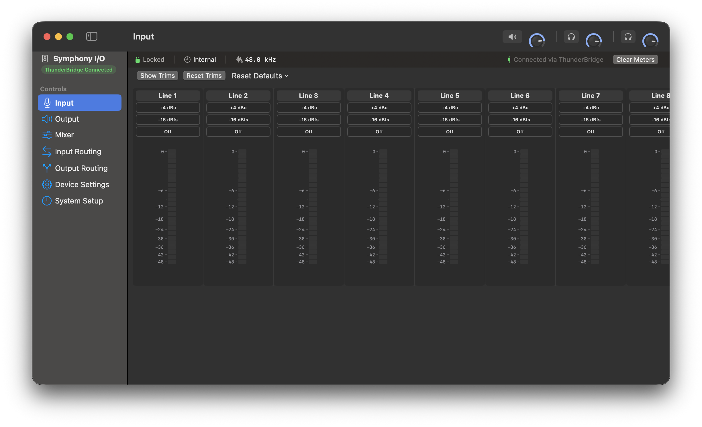</a><br><sub><b>Input</b> — a strip per installed converter: analog and digital reference, soft limiter, meters, and trims on demand.</sub></td>
<td width="50%"><a href="docs/screenshots/output.png">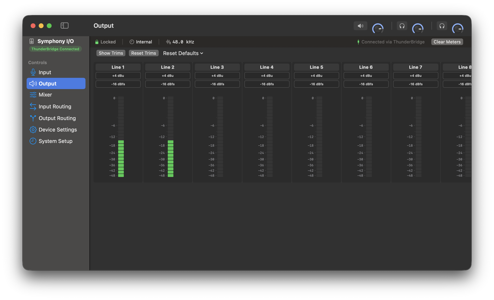</a><br><sub><b>Output</b> — the same per channel on the way out, plus the monitor section to the right.</sub></td>
</tr>
<tr>
<td width="50%"><a href="docs/screenshots/headphones-speakers.png">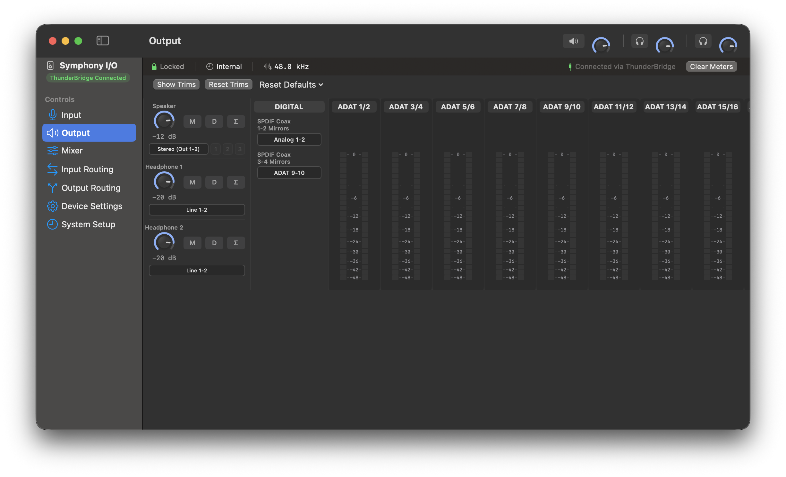</a><br><sub><b>Speaker and headphones</b> — the monitor section: level, Mute / Dim / Sum, and what each output listens to.</sub></td>
<td width="50%"><a href="docs/screenshots/mixer.png">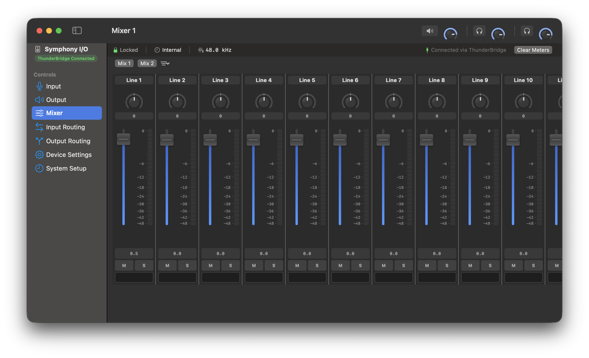</a><br><sub><b>Mixer</b> — two low-latency mixes, each with pan, fader, mute and solo.</sub></td>
</tr>
<tr>
<td width="50%"><a href="docs/screenshots/input-routing.png">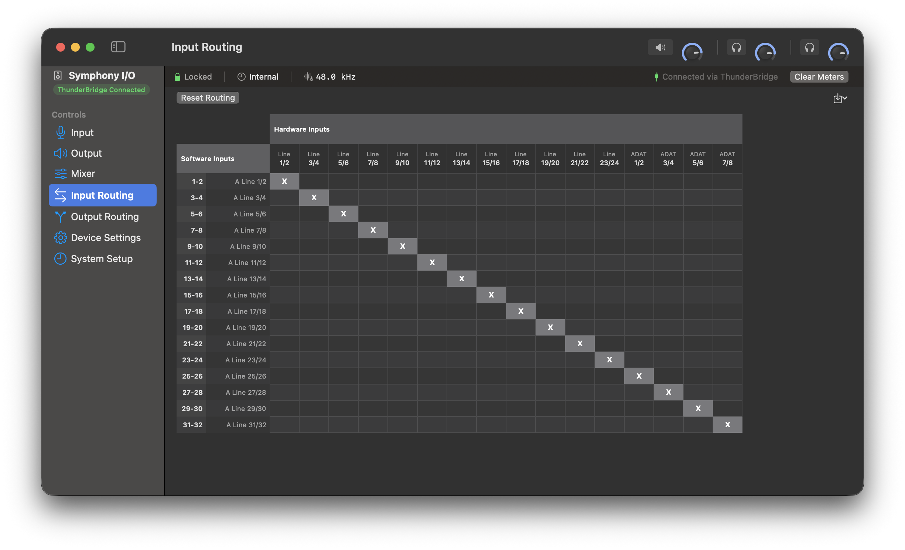</a><br><sub><b>Input Routing</b> — which hardware input feeds which software input.</sub></td>
<td width="50%"><a href="docs/screenshots/output-routing.png">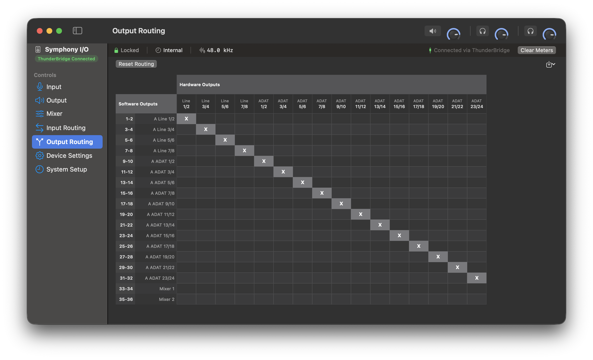</a><br><sub><b>Output Routing</b> — which software output or mix feeds which hardware output.</sub></td>
</tr>
<tr>
<td width="50%"><a href="docs/screenshots/device-settings.png">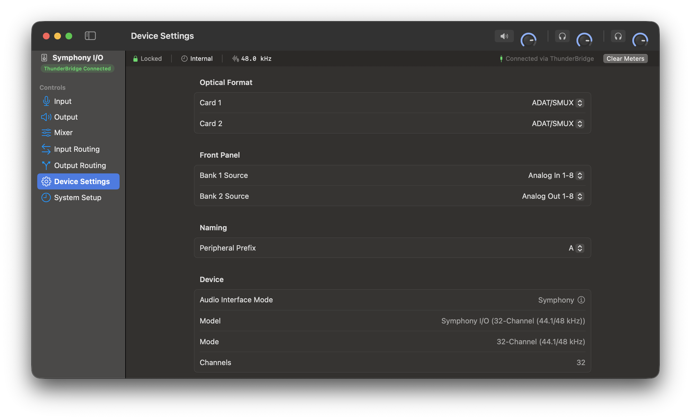</a><br><sub><b>Device Settings</b> — front-panel meter banks, peripheral prefix, and editable insert labels.</sub></td>
<td width="50%"><a href="docs/screenshots/system-setup.png">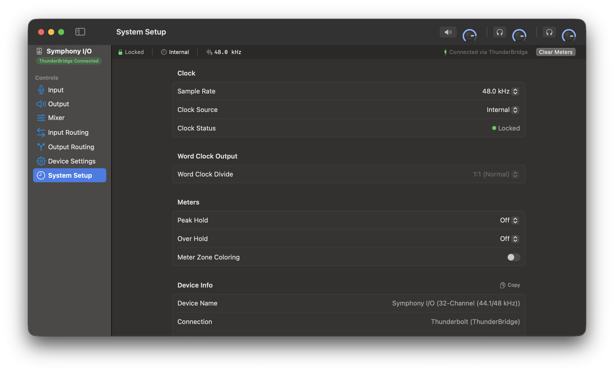</a><br><sub><b>Device Settings</b> — clock and sample rate, word clock divide, meter hold behaviour, and device info.</sub></td>
</tr>
<tr>
<td width="50%"><a href="docs/screenshots/usb-connection.png">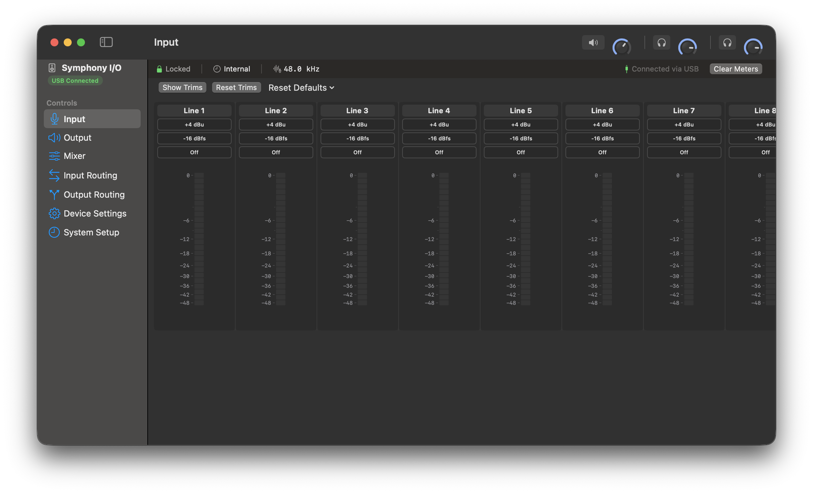</a><br><sub><b>USB connection</b> — USB supports up to 96 kHz; ThunderBridge supports up to 192 kHz where the hardware supports it.</sub></td>
<td width="50%"><a href="docs/screenshots/maestro-help.png">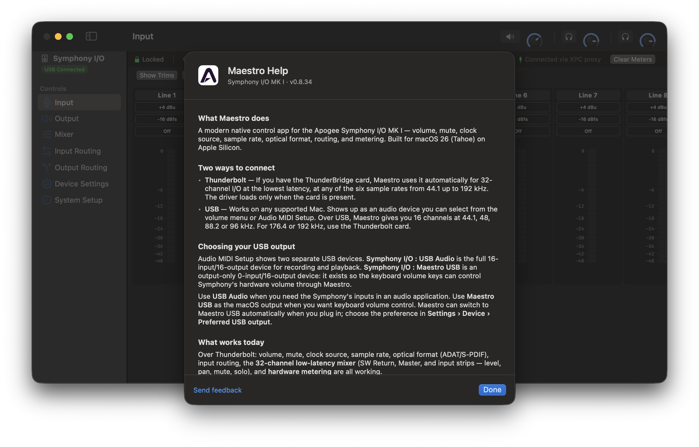</a><br><sub><b>Built-in Help</b> — contextual explanations are available throughout Maestro.</sub></td>
</tr>
<tr>
<td width="50%"><a href="docs/screenshots/diagnostics-toggle.png">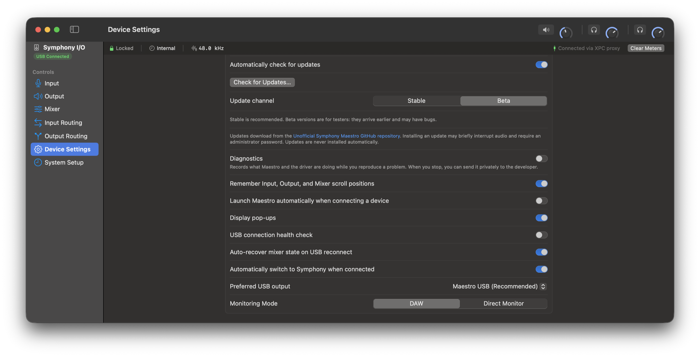</a><br><sub><b>Update channel and Diagnostics</b> — choose Stable or Beta updates; turn on Diagnostics to record what Maestro and the driver do while you reproduce a problem.</sub></td>
<td width="50%"><a href="docs/screenshots/diagnostics-confirm.png">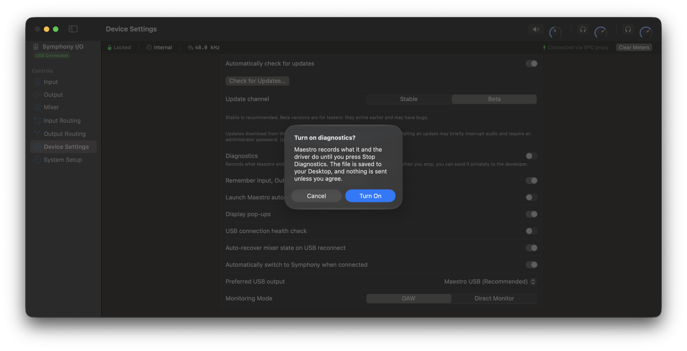</a><br><sub><b>You stay in control</b> — Maestro asks first, saves the report to your Desktop, and sends nothing unless you agree.</sub></td>
</tr>
<tr>
<td width="50%"><a href="docs/screenshots/diagnostics-on.png">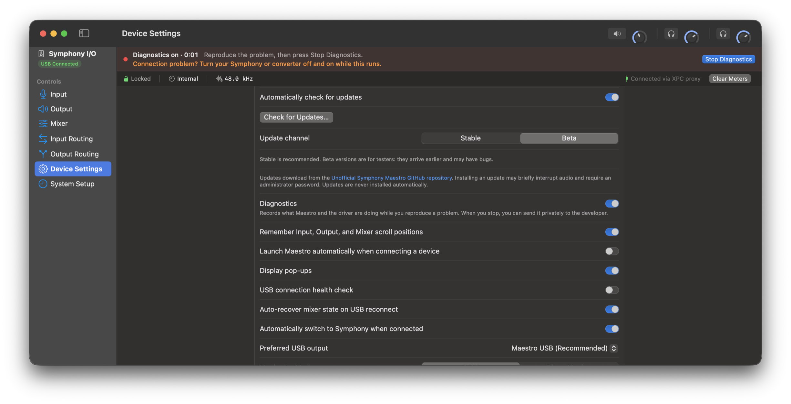</a><br><sub><b>While it records</b> — a bar shows the time and a Stop Diagnostics button, and suggests switching the unit off and on for connection problems.</sub></td>
<td width="50%"><a href="docs/screenshots/diagnostics-form.png">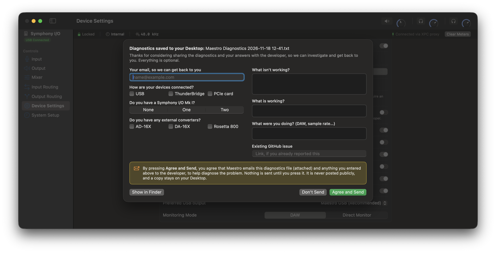</a><br><sub><b>Send it privately</b> — tick your setup, describe the problem, link a GitHub issue if you have one, and email the report to the developer. Everything is optional.</sub></td>
</tr>
<tr>
<td width="50%"><a href="docs/screenshots/diagnostics-sent.png">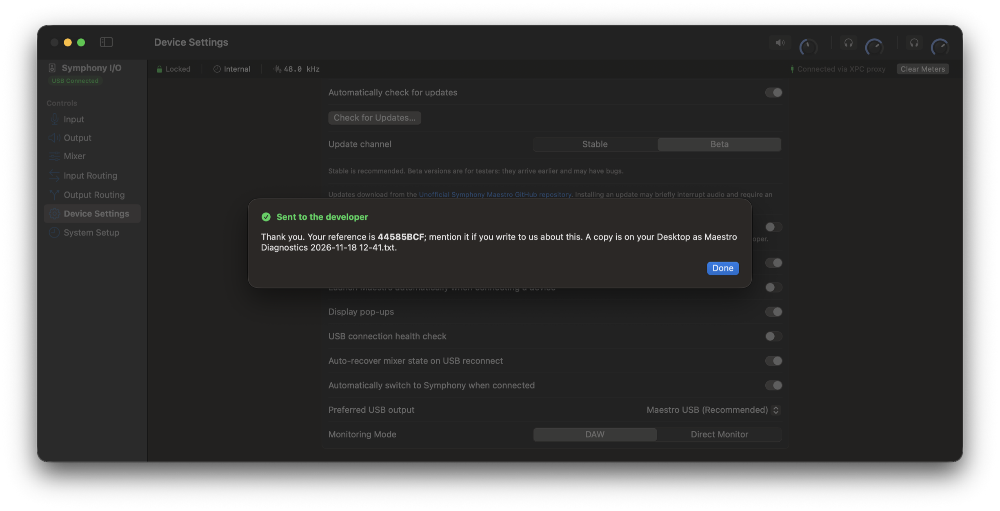</a><br><sub><b>Sent</b> — you get a reference to quote; a copy stays on your Desktop.</sub></td>
<td width="50%"></td>
</tr>
</table>


## What's Included

- **Maestro**, a native macOS app for device configuration: inputs, outputs, monitor section, two low-latency mixers, input and output routing with presets, device and system settings
- A native **ThunderBridge DriverKit driver** (32 channels in and out, 44.1–192 kHz where the installed converter FPGA supports it, ADAT and optical output; channel names in Maestro, Audio MIDI Setup and DAWs follow each card's optical format and sample rate)
- A modern **USB** implementation using Apple's USB audio stack, with hardware volume-key support
- Automatic recovery when the Symphony is powered off and on or a cable is replugged, on either connection
- Appearance controls with **Auto**, **Light**, and **Dark** modes
- Optional in-app updates through Sparkle, with **Stable** and **Beta** channels: stay on a stable build, or choose Beta to get updates before they reach Stable (see [Beta versions](#beta-versions))
- **In beta, not yet confirmed on real hardware:** Apogee [AD-16X](https://www.apogeedigital.com/pdf/ad16x_usersguide.pdf), [DA-16X](https://apogeedigital.com/pdf/da16x_usersguide.pdf) and [Rosetta 800](https://apogeedigital.com/pdf/rosetta800_usersguide.pdf) converters, and two Symphony I/O units (64 channels), over [ThunderBridge or the Symphony 64 PCIe card](https://knowledge.apogeedigital.com/symphony64-pcie-thundebridge-users-guide-documentation-and-downloads). Reports are welcome.

### Connecting over USB and ThunderBridge

Both connections can stay plugged in. The Symphony's front-panel mode decides which one Maestro uses: in **Symphony** mode audio and control go through ThunderBridge, and in a **USB** mode they go through USB. Switching modes on the front panel is followed automatically.

Over USB the Mac sees two devices. Use **Symphony I/O : Maestro USB** for the Mac’s sound output and volume keys. It has no inputs. For recording, or a DAW that wants one device for inputs and outputs, choose **Symphony I/O : USB Audio**. USB carries 16 channels each way; ThunderBridge carries 32.

Some older AD16 option-board FPGA revisions report a valid 192 kHz clock but may deliver corrupt samples on the secondary 16-channel path. 192 kHz remains available so the behavior can be diagnosed and so systems that do not exhibit the issue are not unnecessarily restricted. If your unit shows full-scale or otherwise corrupt secondary inputs at 192 kHz, use a lower rate while reporting the exact module and FPGA revision in an issue.

### Mic Pre

With an 8MicPre installed, channels 1-8 gain a preamp: gain, 48 V phantom, polarity, an 80 Hz high-pass, Group, and the Insert controls. Only the first four channels offer Instrument, because that is how many 1/4" jacks the module has.

<a href="docs/screenshots/input-micpre.png">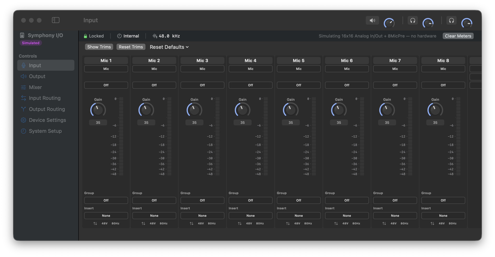</a>

> **The device-control screenshots use Maestro’s built-in card simulator**, with a 16x16 Analog In/Out module and an 8MicPre where shown. The “no hardware” banner identifies simulated views. I don't own an 8MicPre and the Mic Pre controls are based on the documented hardware behavior and have been exercised by one tester on real hardware (see [Tested Hardware](#tested-hardware)). If you wish to contribute a PR for integrating the 8MicPre into Logic like the original there's a <a href="https://github.com/danielraffel/unofficial-symphony-maestro-mk1/issues/29">bug with additional info</a>.

## Requirements

- Apple Silicon Mac (M-series)
- macOS 26 (Tahoe) or later
- Apogee Symphony I/O MK I, connected over USB or an Apogee ThunderBridge

## Known Issues
_Intel Macs and earlier versions of macOS are not supported._

_The original Symphony 64 PCIe card (in a Thunderbolt chassis): the driver attaches to it as of 0.8.36; it has had little testing on that hardware. AD-16X, DA-16X, DD-16X and Rosetta 800 converters are identified as of 0.8.36, also unverified; beta 0.9.3 adds the Mac's volume keys for them._

_Converters work as in Apogee's software: up to four units on each port, in cable order with the nearest first. Port 1's units take the first channels and port 2's continue after them while 64 channels run. Channels are named per unit (A Line 1, C Line 1). Each unit needs X-Symphony firmware 2.7 or later. Device Settings › Info has a Device Type menu for a DD-16X (or an AD-16X or DA-16X in Advanced Routing) and for a Rosetta 200, and the clock can be internal or external word clock. Output Routing and Input Routing edit the card's routing for converters both ways (any DAW output or mixer to any converter output, any converter input to any DAW input), starting from the default placement; Reset Routing returns both to it, and your routes are remembered per chain of units._

_Stable versions work with one Symphony I/O at a time. The 0.9 betas add two units (64 channels) over ThunderBridge, not yet verified on hardware._

_As of 0.8.40, option-card features (optical format, S/PDIF coax, AES, per-card clock choices) follow Apogee's original software. They are verified on an 8x8 AES/OPT and an A16 IP; the AES-only 8x8, 2x6, 16x16 and A16 OP are unverified, and reports are welcome._

## Project status

Maestro is young software developed by one person. It has been tested on a small number of systems, listed below. (This is separate from the optional Beta update channel.) If your Mac is mission-critical, you may prefer to test on a secondary machine first.

## Tested Hardware

Verified by me, on macOS 26 and macOS 27:

- Symphony I/O MK I with an **8×8 Analog + Optical** module and a **16 Analog In / 16 Digital Out** module, over **USB** and **ThunderBridge**

Reported working by testers (thank you):

- **8×8 Analog + Optical**, single module, over ThunderBridge, macOS 26
- **16×16 Analog** + ADAT over ThunderBridge, macOS 27
- **16×16 Analog** over USB, macOS 26 and 27
- **16×16 Analog** + **8MicPre** over USB, macOS 26

If your configuration differs, it may work, but it has not been verified.

## Installation

The installer is Apple signed and notarized, so no security workarounds are needed. Install, launch Maestro, and approve the driver extension when macOS asks (ThunderBridge users). After a driver update, once Maestro has reopened, unplug the ThunderBridge cable and plug it back in (audio stops for a few seconds). You can instead turn the driver off and on in System Settings › General › Login Items & Extensions, or restart your Mac. Maestro shows a banner until the new driver is running. The release notes say when a release updates the driver.

The project source is available under the [MIT license](license.md), without warranty. Third-party components retain their own licenses. Previously published installers retain their original embedded notices.

## Feedback

If you have a Symphony I/O MK I and an Apple Silicon Mac, I’d appreciate hearing how it goes.

**The best way to report a problem is Diagnostics.** Turn it on in **App Settings › Diagnostics & Feedback**, use your Symphony until the problem happens (for a connection problem, switch the unit off and on while it runs), then press **Stop Diagnostics**. Maestro saves the report to your Desktop, so you can see exactly what it collected, and offers to email it privately to the developer; it is never posted publicly. Fill in what you can on the form, and if you have opened a GitHub issue, paste its link so the two can be matched. This is what we use to find and fix problems.

**Fixes and new hardware support arrive on Beta first.** Stable is the default and is kept working smoothly. Bug fixes and new hardware support (such as the PCIe card, 64 channels and converters) go out on the Beta channel, and move to Stable once testers confirm they work. You can switch channels in **App Settings › Updates** at any time.

If you encounter problems, please <a href="https://github.com/danielraffel/unofficial-symphony-maestro-mk1/issues/new?template=bug_report.yml">file an issue</a> and include:

* The Maestro version (**Maestro › About**) and macOS version
* Whether you’re using USB or ThunderBridge
* Installed I/O modules
* Mac model

If everything works, a <a href="https://github.com/danielraffel/unofficial-symphony-maestro-mk1/issues/new">short issue</a> saying so is just as valuable: it tells others which configurations have been tested, and it gets added to the list above.

## Support

This is an independent community project. Apogee does **not** provide support for this software. Please direct all feedback, bug reports, and questions to this project's GitHub Issues page.

The source is available for community maintenance, learning and further development. Most users should use the prebuilt installer.

## Acknowledgments

Many thanks to Apogee for their cooperation during development, for trusting me and for making it possible to explore restoring support for this hardware on modern versions of macOS. “Apogee”, “Symphony”, “Maestro”, “AD-16X”, “DA-16X” and “Rosetta 800” are trademarks of their respective owners, used here only for identification and compatibility.

Thanks also to the testers who have filed detailed reports on GitHub and in the Gearspace thread; most of the fixes since the first beta came directly from them.

During development I sent countless commands that could easily have bricked my device, while I did have to reboot my machine a lot I never encountered a single unrecoverable issue. That’s a real testament to the engineering and care that went into the Apogee firmware. The team clearly designed it to guard against invalid states, preventing me from ever putting the hardware into a bad or unrecoverable condition. Respect.

## Appendix
- <a href="https://knowledge.apogeedigital.com/legacy-symphony-i/o-mk-i-guide-for-intel-and-apple-silicon-macs">About Apogee Symphony I/O MK I</a><br>
- <a href="https://www.soundonsound.com/reviews/apogee-symphony-io">Sound on Sound Review of Apogee Symphony I/O MK I</a>
- <a href="https://gearspace.com/threads/apogee-symphony-i-o.516748/page-45">Gearspace Thread Announcing project</a>
- <a href="https://apogeedigital.com/blog/symphony-io-mk1-independent-mac-software/">Apogee blogged about the project</a>

## Appearance and updates

Maestro follows your Mac by default with **Auto** appearance. You can choose **Light** or **Dark** in **App Settings › General**; the choice applies only to Maestro and is saved for the next launch.

Updates are downloaded from this repository; the updater collects no telemetry.

### Beta versions

From 0.8.40, Maestro can also offer beta versions: builds that are still being tested and may have bugs. They are for people helping to test, and are not recommended for anyone else. Stable is the default. To get betas, choose Beta under Update channel in App Settings › Updates; choosing Stable again offers to reinstall the latest stable version. Betas are listed as pre-releases on the Releases page. Bug fixes and new hardware support land on Beta first and move to Stable once they have been tested.

<table>
<tr>
<td width="50%"><a href="docs/screenshots/appearance-light.png">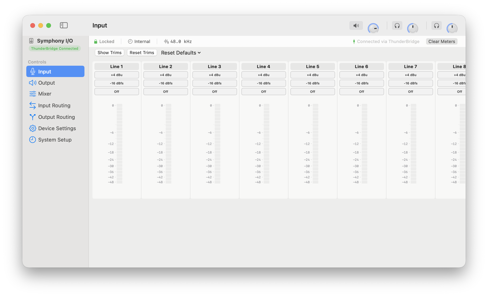</a><br><sub>Maestro also supports a clean Light appearance, selected in App Settings.</sub></td>
<td width="50%"></td>
</tr>
<tr>
<td width="50%"><a href="docs/screenshots/update-available.png">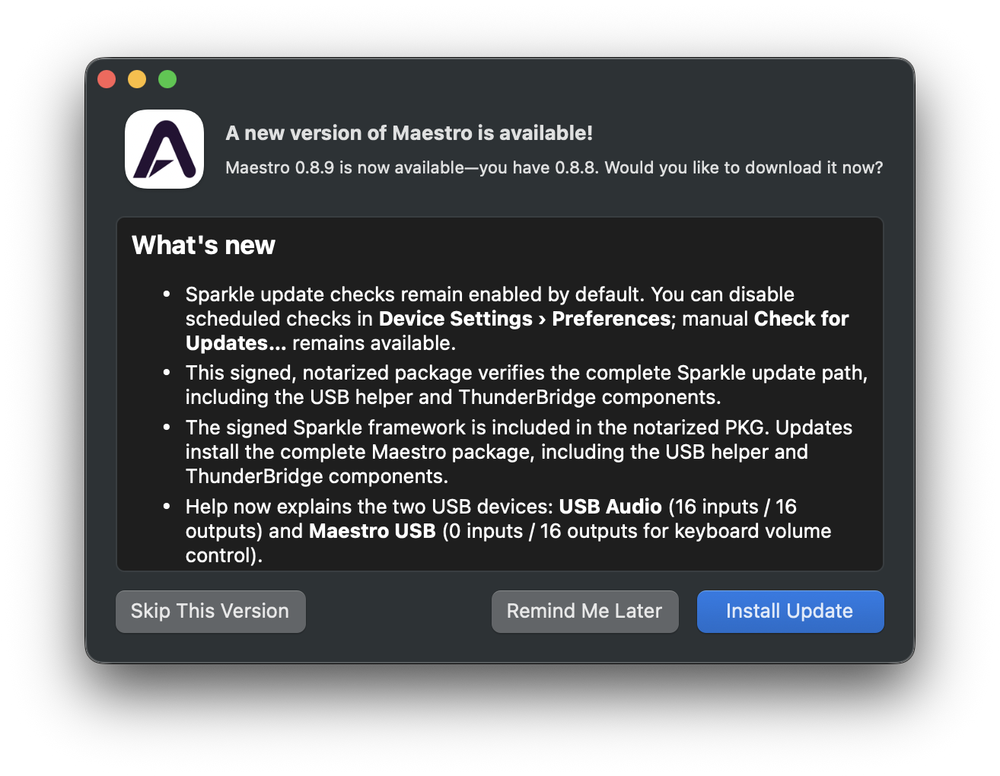</a><br><sub>Update notifications show the release notes before you install.</sub></td>
<td width="50%"><a href="docs/screenshots/update-current.png">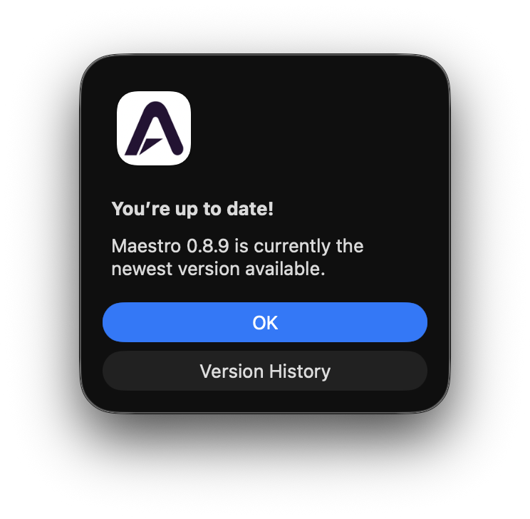</a><br><sub>Manual checks also report when you are already up to date.</sub></td>
</tr>
</table>


## Uninstalling Unofficial Symphony Maestro

To remove everything this project installs, run this one command in Terminal (in Applications › Utilities) and enter your Mac's password when asked:

```
sudo /Applications/Maestro.app/Contents/Resources/uninstall.sh
```

It removes the Unofficial Symphony Maestro app, its audio plug-in, its ThunderBridge driver and its background service, and restores Apogee's original audio plug-in if our installer had set it aside. Audio stops briefly while it runs. macOS may not let the script remove the driver itself; if so, the script says so, and you turn off **Symphony Thunderbridge** under **System Settings › General › Login Items & Extensions › Driver Extensions**. The script does not run while Apogee's original ThunderBridge or PCIe driver is loaded and Maestro's driver is active: stopping Maestro's driver then can crash your Mac. It says so and changes nothing; shut down your Mac, disconnect the ThunderBridge or PCIe chassis, start up again, and run it again.

If you have already deleted the app from Applications, the same script is in this repository at [Installer/uninstall.sh](Installer/uninstall.sh).

## Going back to Apogee's official software

Unofficial Symphony Maestro and Apogee's own Symphony I/O software can't be installed side by side: their drivers interfere with each other. To use Apogee's official software again:

1. Uninstall Unofficial Symphony Maestro with the command above.
2. Restart your Mac.
3. Download Apogee's installer, [Symphony I/O Release 5.5](https://knowledge.apogeedigital.com/hubfs/Software%20Installers/Symphony%20IO/SymphonyIO_Release_5.5.dmg), open it and choose **Install**.
4. For anything beyond that, such as which Macs and macOS versions it runs on, see Apogee's own guide: [Legacy Symphony I/O MK I guide for Intel and Apple Silicon Macs](https://knowledge.apogeedigital.com/legacy-symphony-i/o-mk-i-guide-for-intel-and-apple-silicon-macs).

Apogee's software is theirs, not ours: we don't provide, test or support it, and Apogee doesn't support this project.

## Coming from Apogee's official software

Going the other way, remove Apogee's Symphony I/O software before installing Unofficial Symphony Maestro. If it is still there, our installer stops and says: "Apogee's original Symphony I/O drivers were detected. Symphony Maestro cannot be installed or updated while they are installed or loaded. Running both can crash your Mac and make it restart repeatedly." To fix this:

1. Download Apogee's latest installer, [Symphony I/O Release 5.5](https://knowledge.apogeedigital.com/hubfs/Software%20Installers/Symphony%20IO/SymphonyIO_Release_5.5.dmg)
2. Open the DMG and choose **Uninstall**
3. Restart your Mac
4. Run this installer again (Apogee's Uninstall also removes Maestro; this puts it back)

A first install stops while any part of Apogee's original Symphony I/O software is found. An update stops while Apogee's driver for the ThunderBridge or PCIe card is loaded or is in an Extensions folder; a copy that only macOS has kept does not stop an update, and Maestro's Device Settings warns about it. The details, and what to do if you are still blocked, are in the user guide under [Removing Apogee's original drivers](https://github.com/danielraffel/unofficial-symphony-maestro-mk1/blob/dev/docs/UserManual.md#removing-apogees-original-drivers). We can't troubleshoot removing Apogee's software ourselves. If you found something that worked, or are stuck, other users compare notes in this issue: https://github.com/danielraffel/unofficial-symphony-maestro-mk1/issues/32

On some Macs, macOS keeps loading Apogee's old drivers even after their uninstaller has run. One user worked out why and how they cleared it, and wrote it up in detail: [their report](https://github.com/danielraffel/unofficial-symphony-maestro-mk1/issues/32#issuecomment-7050613371). It's one person's experience on their own Mac, shared in case it helps, and not a procedure we've tested.

## Source and development

The repository includes the Maestro desktop app, shipping ThunderBridge and USB support, installer resources, and build/install tools. Source is provided for learning, maintenance and further development. **We strongly recommend the prebuilt, signed and notarized installer for everyday use.**

**Building and distributing the complete driver package requires appropriate Apple Developer certificates, provisioning profiles and approved DriverKit entitlements.** Private signing keys and profiles are not included. Keep SIP enabled and obtain the required approvals rather than relying on development security bypasses. Testing and development with SIP disabled is not recommended. See the [advanced build instructions](docs/BUILDING.md) for Apple entitlement requirements and private signing setup, and [contributor guidance](AGENTS.md) for release boundaries.
